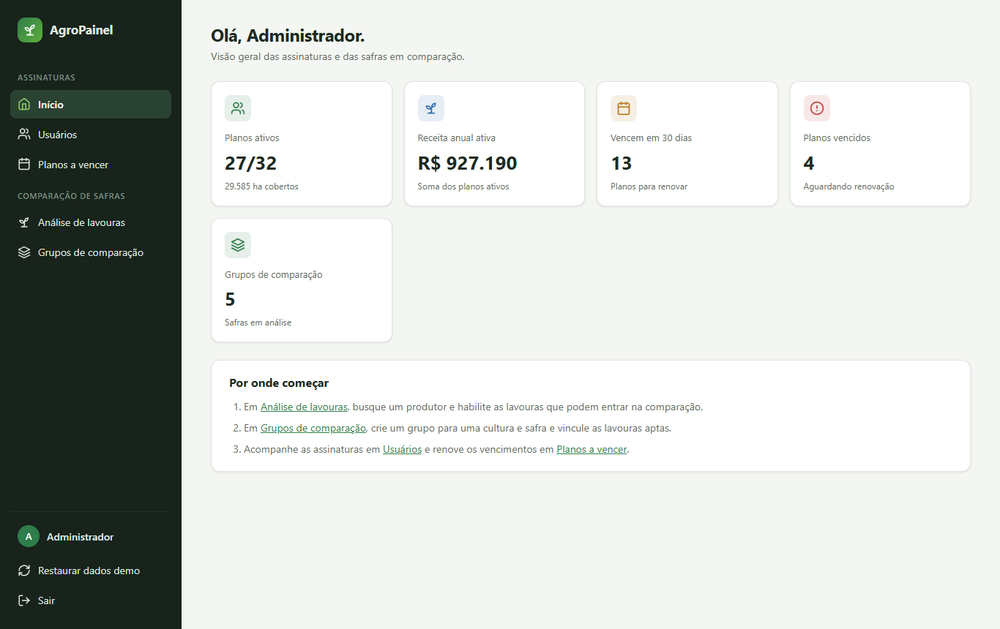
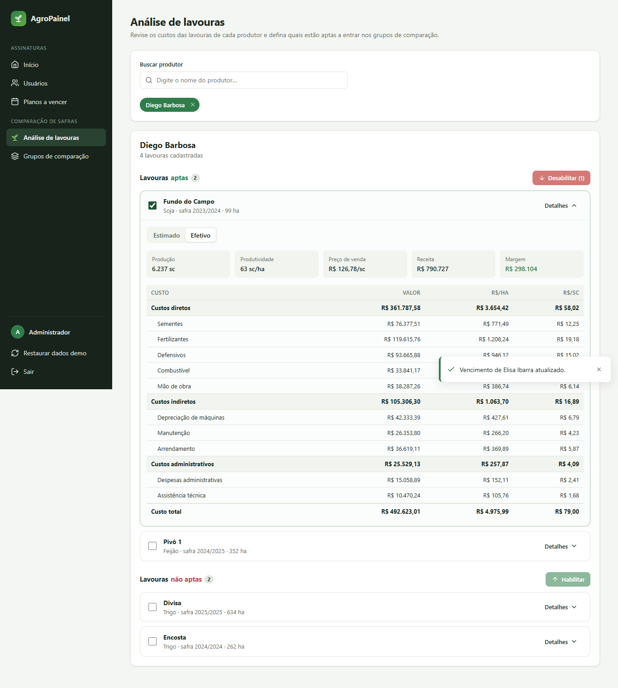
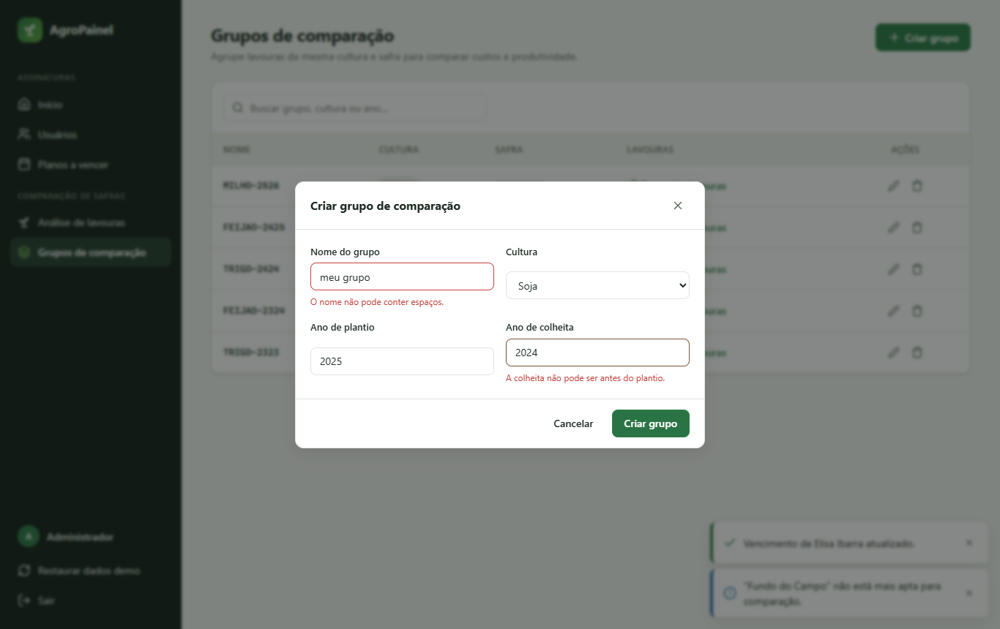
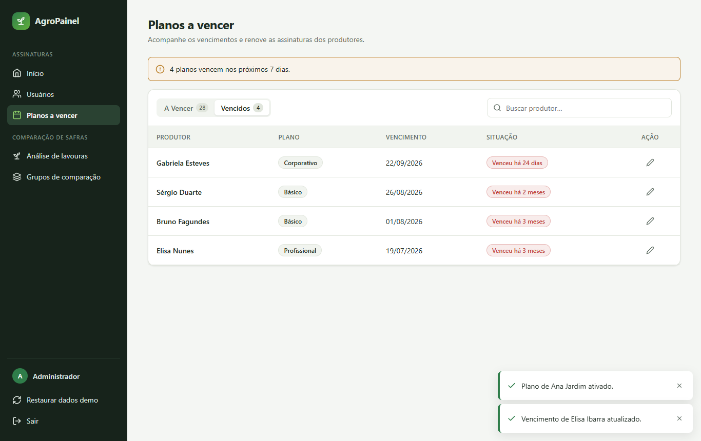
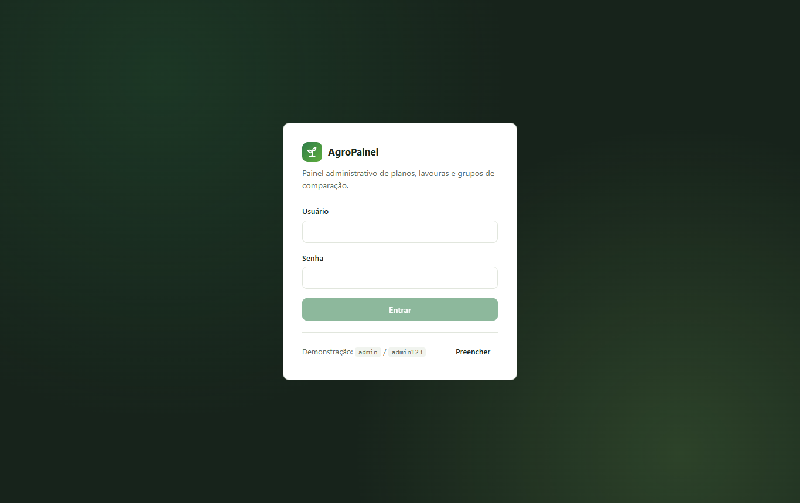

# AgroPainel

Painel administrativo para uma plataforma de gestão agrícola: controle de assinaturas dos produtores, análise de custos das lavouras e montagem de **grupos de comparação de safra**.

| | Link | Como funciona |
|---|---|---|
| **▶ App completo** | [agro-painel.onrender.com](https://agro-painel.onrender.com) | Angular + API Express com JWT no Render. No plano gratuito, o primeiro acesso depois de um tempo parado leva cerca de 30 segundos. |
| **⚡ Demo instantânea** | [cristianandrade23.github.io/agro-painel](https://cristianandrade23.github.io/agro-painel/) | Só o frontend, no GitHub Pages. A mesma API roda dentro do navegador. |

Usuário `admin`, senha `admin123`.



> Projeto de portfólio. Nasceu como o painel interno de um produto real (Angular 8) e foi **reescrito em Angular 22** com componentes standalone, signals e change detection zoneless, mais um **backend em Express**. A marca, os dados e o backend originais foram removidos, e todos os dados são fictícios.

## Funcionalidades

| Tela | O que faz |
|---|---|
| **Início** | Indicadores de planos ativos, receita, vencimentos próximos e grupos. |
| **Usuários** | Lista paginada com busca e filtro por status; ativa ou desativa o plano com confirmação. |
| **Planos a vencer** | Abas "a vencer" e "vencidos", ordenadas por urgência, com badges e alteração da data de vencimento (inclui atalho "+1 ano"). |
| **Análise de lavouras** | Busca de produtores (autocomplete acessível); custos diretos, indiretos e administrativos em cenário estimado ou efetivo; receita e margem; habilitar ou desabilitar lavouras em lote para comparação. |
| **Grupos de comparação** | CRUD de grupos por cultura e safra, com validação reativa, e vínculo de lavouras aptas compatíveis. A exclusão é bloqueada enquanto houver lavouras vinculadas. |

| | |
|---|---|
|  |  |
|  |  |

## Stack e decisões técnicas

- **Angular 22**: 100% **standalone components**, sem `NgModule`.
- **Signals em todo o estado**: `signal`, `computed`, `linkedSignal` (por exemplo, a página volta para 1 quando o filtro muda), `input()`, `output()` e `model()`.
- **`rxResource`** para carregamento de dados, com estados de loading, erro e reload declarativos.
- **Zoneless**: sem `zone.js`; a detecção de mudanças é guiada por signals, com `OnPush` em todos os componentes.
- **Nova sintaxe de template**: `@if`, `@for`, `@let`.
- **Rotas com lazy loading** (`loadComponent`), **guards** e **interceptors** funcionais.
- **Backend Express 5 + JWT** em [`backend/`](backend), com TypeScript executado direto pelo Node (type stripping, sem etapa de build), testes com `node:test` e o mesmo servidor entregando a API e o Angular.
- **Uma única regra de negócio para dois ambientes**: as rotas da API ficam em [`src/app/core/backend/routes.ts`](src/app/core/backend/routes.ts), TypeScript puro usado tanto pelo Express quanto pelo `HttpInterceptorFn` da demo estática. Por isso as duas versões não divergem.
- **Componentes de UI próprios, sem bibliotecas**: modal sobre `<dialog>` nativo, autocomplete com navegação por teclado e ARIA, paginação e toasts.
- **CSS próprio** com design tokens e **tema escuro** automático (`prefers-color-scheme`).
- **Testes unitários com Vitest**, o runner padrão do Angular 22.
- **Testes end-to-end com Cypress**: 37 cenários cobrindo login, guards, as cinco telas, CRUD, validações e layout mobile. Rodam **nos dois modos**: contra a API no navegador e contra o servidor Express real. Os dados esperados vêm do mesmo seed da API, então nenhum nome fica fixo no código dos testes.
- **CI/CD com GitHub Actions**: testes unitários, de API e E2E e deploy da demo no GitHub Pages. O Render faz o deploy do app completo a cada push.

### Estrutura

```
backend/                  # API Express 5 + JWT (Node executa o TypeScript direto)
├── src/app.ts            # rotas HTTP; delega /admin/* para core/backend/routes.ts
├── src/auth.ts           # login e verificação do JWT
├── src/server.ts         # porta, segredo, e entrega do build do Angular
└── test/                 # testes da API (node:test)
src/app
├── core/                 # regras independentes de tela
│   ├── backend/          # regras da API e seed de dados fictícios (compartilhados com o Express)
│   ├── mock/             # adaptador da API para o navegador (modo demo)
│   ├── api/              # serviços HTTP por domínio (planos, lavouras, grupos)
│   ├── auth/             # sessão (signals), interceptor de token, guards
│   ├── models.ts         # contratos da API
│   └── dates.ts          # datas da API ([ano, mês, dia]) e textos relativos
├── shared/               # UI reutilizável: modal, autocomplete, paginator, toast, ícones
└── features/             # uma pasta por tela (lazy loaded)
    ├── login/  shell/  home/  users/  expiring-plans/
    ├── farming-analysis/ # página + painel do produtor + card de lavoura
    └── groups/           # página + formulário + vínculo de lavouras
```

### O que mudou em relação à versão original (Angular 8)

- `NgModule` + `ngx-bootstrap` + `jQuery` + `moment` + Bootstrap 3 → standalone + signals, sem dependências de UI de terceiros.
- Navegação por "abas" controladas por número → rotas reais, com lazy loading e títulos de página.
- Componentes duplicados (`lavouras` e `pendentes`) → um único `FarmingCard`.
- Validações imperativas em `ngDoCheck` → erros derivados com `computed()`.
- Datas tratadas fatiando strings do moment.js → `Intl.RelativeTimeFormat` com funções puras e testadas.
- Bundle inicial de cerca de 90 kB transferidos, e cada tela carregada sob demanda.

## Como rodar

Pré-requisito: **Node.js 24 ou mais recente**. O `npm install` também instala as dependências do `backend/`.

```bash
npm install
```

Depois, escolha um modo:

| Modo | Comando | Endereço |
|---|---|---|
| Só o frontend (API no navegador) | `npm start` | http://localhost:4200 |
| Frontend + API, em desenvolvimento | `npm run api` num terminal e `npm run start:api` em outro | http://localhost:4200 |
| Como em produção (build servido pelo Express) | `npm run serve:prod` | http://localhost:3000 |

Entre com `admin` / `admin123` (o botão **Preencher** na tela de login completa os campos). Use **Restaurar dados demo** no menu lateral para voltar os dados ao estado inicial.

```bash
npm test           # testes unitários do frontend (Vitest)
npm run test:api   # testes da API (node:test)
```

### Testes end-to-end (Cypress)

```bash
npm run e2e          # modo demo: sobe o ng serve e roda os testes no Chrome headless
npm run e2e:server   # modo servidor: build de produção + Express, com JWT real
npm run e2e:open     # interface interativa do Cypress
```

Com o app já rodando (`npm start`), também dá para usar `npm run cy:run` ou `npm run cy:open` diretamente.

| Spec | Cobre |
|---|---|
| `auth.cy.ts` | login válido e inválido, guards, sessão após reload, logout |
| `dashboard.cy.ts` | indicadores, navegação pelo menu e pelos cards |
| `users.cy.ts` | paginação, busca sem acento, filtro de status, ativar e desativar com persistência |
| `expiring-plans.cy.ts` | abas, ordenação por urgência, validação de data, renovação |
| `farming-analysis.cy.ts` | autocomplete por teclado, custos estimado e efetivo, habilitar e desabilitar em lote |
| `groups.cy.ts` | validações, nome duplicado, criar, editar e excluir, regras de grupos com lavouras, vínculo de lavouras |
| `responsive.cy.ts` | menu mobile |

> Os scripts usam [`scripts/cypress.mjs`](scripts/cypress.mjs), que remove a variável `ELECTRON_RUN_AS_NODE` herdada do terminal do VS Code. Sem isso, o Cypress falha com `bad option: --smoke-test`.

## Deploy

**App completo no Render.** O arquivo [`render.yaml`](render.yaml) descreve o serviço: build do Angular, start do Express, health check e um `JWT_SECRET` gerado automaticamente.

[](https://render.com/deploy?repo=https://github.com/CristianAndrade23/agro-painel)

No Render, use *New → Blueprint*, escolha este repositório e confirme. Depois disso, cada push na branch principal faz um novo deploy. Os dados ficam em memória e voltam ao seed quando o servidor reinicia.

**Demo estática no GitHub Pages.** O workflow [`.github/workflows/ci.yml`](.github/workflows/ci.yml) roda os testes unitários, de API e E2E e só publica a demo se tudo passar.

## Licença

[MIT](LICENSE)
